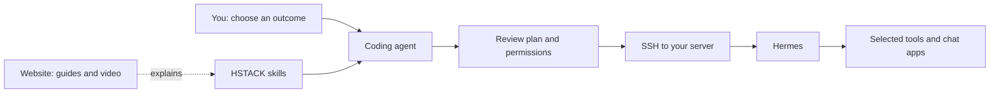

<div align="center">

# hstack

**Setup guides your coding agent can follow to run Hermes on your server.**

[](skills/)
[](skills/)
[](skills/)
[](LICENSE)

[Website](https://hstack-website.vercel.app/) · [Watch the walkthrough](https://hstack-website.vercel.app/#demo) · [Get started](#get-started) · [Documentation](docs/README.md)

</div>

## The original project and the new website

The original HSTACK project is the skill catalogue, installers and local planning
tools in this repository. The new website gives that work a readable home: setup
guides, an integration directory and a video walkthrough. It does not restart
maintenance or change the validation status of the underlying skills.

- [Browse the website](https://hstack-website.vercel.app/)
- [Watch the walkthrough](https://hstack-website.vercel.app/#demo)
- [Website source](https://github.com/paarths-collab/hstack-website) — maintained in a separate repository
- [Project history](docs/project-history.md) — original scope and later presentation work

## Video walkthrough

[Watch the HSTACK video](assets/hstack-promo.mp4)

**Website:** [hstack-website.vercel.app](https://hstack-website.vercel.app/)

## What it does

Your coding agent reads a skill, explains the plan, and follows the setup steps
over SSH. You supply the server, access and credentials. No hstack account or
hosted relay is required.

> “Set up Hermes on my server and connect Telegram.”
>
> “Help me connect GitHub and Notion.”
>
> “Check why my Hermes gateway is offline.”

| Area | Included |
|---|---|
| Setup and maintenance | Installation, model configuration, health checks, gateway restart, backups and recovery |
| Integrations | 71 service guides, including GitHub, Notion, Linear, Postgres and Supabase |
| Messaging | Telegram, Slack, Discord, WhatsApp, Teams, Signal, Google Chat and Mattermost |
| Planning | Blueprints and a local browser composer for reviewing a setup before deployment |

The skills provide procedures, not pre-connected services. Installing them does
not deploy Hermes, authorize an account or activate a workflow.

## How it fits together



The website explains the setup; execution happens through your coding agent and
your server.

## Get started

Choose one installation method.

### Claude Code

Run inside Claude Code:

```text
/plugin marketplace add paarths-collab/hstack
/plugin install hstack@hstack
```

Start a new session, then ask for help or invoke `/hstack:hermes-status`.

### Codex

```bash
codex plugin marketplace add paarths-collab/hstack --ref main
```

Open `/plugins`, select the **hstack** marketplace and install **hstack**.
Start a new session afterwards.

### Other agents and selective installation

```bash
git clone https://github.com/paarths-collab/hstack.git
cd hstack
bash install.sh --pick
```

The installer supports Claude Code, Codex, Cursor, Gemini CLI, OpenClaw and
Hermes. It runs on macOS Bash 3.2 and Linux. For Windows, use `./install.ps1`
from PowerShell; native Windows validation remains pending.

```bash
bash install.sh --ide=claude,codex
bash install.sh --tier=memory,database
bash install.sh --include=notion,github
bash install.sh --help
```

Conflicting user files and edited copies are backed up before replacement.
The installer prints their locations.

For Cursor plugin setup and agent-specific update instructions, see the
[plugin guide](docs/plugins.md).

## Before running a skill

Ask your agent to explain the plan and required permissions before making
changes. Keep credentials in private files, not in chat or the repository.

The deploy procedure targets **Telegram on an exclusive default-profile Linux
server**. The seven-day live reliability gate has not started. Offline checks
do not establish production readiness, and recovery cannot undo sent messages
or arbitrary external side effects.

For a plan you can review first, use the [local Composer](apps/composer/README.md).
It collects no credentials; deployment happens separately on your server.

## Reference

- [Skill catalogue](skills/) — setup and integration procedures
- [Documentation](docs/README.md) — guides and reference material
- [Compatibility](compatibility/README.md) — supported scope and evidence policy
- [Tests](tests/README.md) — checks and their limits
- [Troubleshooting](docs/reference/TROUBLESHOOTING.md) — symptoms and fixes
- [Architecture](docs/architecture.md) — repository structure
- [Security](SECURITY.md) · [Changelog](CHANGELOG.md)

This project is no longer accepting contributions.

---

[Apache 2.0](LICENSE) · Built by **Paarth**

Independent open-source project. Not affiliated with or endorsed by Nous Research
or the integrated vendors.
