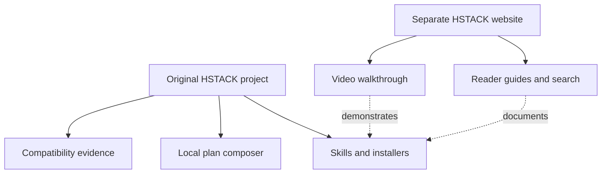

# Project history and website

## Original HSTACK

HSTACK began as a collection of procedures for coding agents to configure
self-hosted Hermes over SSH. The repository includes installers, service and
messaging skills, blueprints, a local composer and regression checks.

The project is archived. Its 97 skills received a one-time compatibility refresh
for Hermes 0.23.2 on 17 November 2026. Source checks and offline regressions are
not proof of live reliability; see the [validation record](../compatibility/VALIDATION.md).

## New website

The [website](https://hstack-website.vercel.app/) presents the original work with
readable guides, searchable integrations, blue artwork and a
[video walkthrough](https://hstack-website.vercel.app/#demo).

Website code now lives in the separate
[hstack-website repository](https://github.com/paarths-collab/hstack-website).
The former `apps/web` directory was removed from this repository. Its earlier
contents remain in Git history. Website changes do not imply renewed support
for the archived skill catalogue.

## Reading older material

Release notes record what was true for each release. Documents under
`docs/archive/` describe historical plans or experiments, not current promises.
Older version numbers in release notes and pinned fixtures are intentional.
Start with the [documentation index](README.md) for the supported reference paths.
